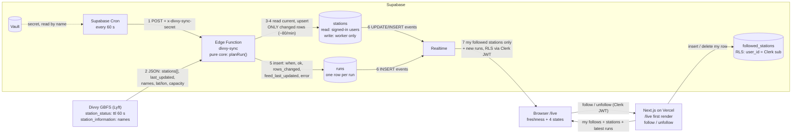

# Live Divvy

A live tracker for Chicago's Divvy bike stations. Each signed-in user follows the stations they care about, and `/live` shows their bikes, e-bikes and open docks changing on their own, with no refreshing, plus how fresh the data is. The weather watchlist from Assignment 4 is still there as a secondary page (**Weather** in the nav).

Built for MPCS 51238 Assignment 5 with Next.js 16, Clerk, Supabase (Postgres, Edge Functions, Cron, Vault, Realtime) and Divvy's public [GBFS feed](https://gbfs.lyft.com/gbfs/2.3/chi/gbfs.json). The source measurements are in [`docs/source.md`](docs/source.md), the design written before any code is in [`docs/data-flow.md`](docs/data-flow.md), and Q&A notes are in [`docs/notes.md`](docs/notes.md).

## Data flow



| # | from → to | what is sent |
|---|-----------|--------------|
| 1 | Cron → Edge Function | An HTTPS POST every minute, with header `x-divvy-sync-secret`. Its value is read from Vault by name when the job runs. |
| 2 | Divvy → Edge Function | Two JSON responses. `station_status` has counts, flags, each station's `last_reported` and the feed's `last_updated`. `station_information` has name, coordinates and capacity. |
| 3–4 | Edge Function → `stations` | Reads the compared columns of all rows, 1,000 at a time. Then upserts only the stations that changed, on `station_id`. |
| 5 | Edge Function → `runs` | One row per run, success or failure: `started_at`, `finished_at`, `ok`, `rows_changed`, `feed_last_updated`, `error`. |
| 6 | Postgres → Realtime | Committed changes to `stations` and `runs`, through the `supabase_realtime` publication. |
| 7 | Realtime → browser | `postgres_changes` for `stations`, filtered to `station_id=in.(my follows)`, plus `runs` inserts. Each event is checked against RLS with the user's Clerk token. |
| – | Browser ↔ Next.js ↔ Postgres | Follow and unfollow are server actions using the user's Clerk token, with RLS on `followed_stations`. The first render reads the user's follows, their station rows, the latest run and the latest successful run. |

## Why every 60 seconds

`station_status` advertises `ttl: 60`, and its `last_updated` moved by about 60 s between every pair of fetches. Polling faster would mostly fetch the same snapshot again. Polling slower would skip snapshots.

Free-tier math (Supabase Free):

| | per month | free quota | share |
|---|---|---|---|
| Edge Function calls (1 per minute) | 60 × 24 × 30 = **43,200** | 500,000 | ~9% |
| Realtime: `runs` events, 5 pages open 24/7 | 5 × 43,200 = 216,000 | 2,000,000 | |
| Realtime: station events, 5 pages × 10 follows | 84k at the average change rate (~4% of stations per minute), 324k if all follows are busy stations | | |
| **Realtime total, worst case** | **about 540,000** | 2,000,000 | ~27% |

An unfiltered `stations` subscription would be about 80 events × 43,200 minutes × 5 pages ≈ 17 M a month, so the page always filters to the user's follows. Realtime's `in` filter takes at most 100 values, and a trigger caps follows at 50 per user.

## What counts as a change

A station is rewritten only when its **counts or flags** change: bikes, e-bikes, docks, disabled bikes and docks, `is_installed`, `is_renting`, `is_returning`, and the derived `is_reporting`. Its info (name, coordinates, capacity) also counts, so renamed or new stations are saved. **`last_reported` never counts.** In the measured fetches, about 700–800 stations bumped `last_reported` each minute, but only about 70–90 had a real change (80 on average across the runs since the coordinate fix). Counting heartbeats would rewrite a third of the table every minute and send a Realtime event for each row.

`is_reporting` is false when a station hasn't reported for over 24 h, measured against the feed's own clock. A station going silent is written once, when it crosses 24 h. The station search only offers stations that are reporting and installed.

## Freshness

The page shows two clocks:

- **Worker updated N s ago:** `finished_at` of the latest successful run.
- **Divvy feed published N s ago:** the feed's own `last_updated` as seen by that run.

A run that changes 0 rows still inserts a `runs` row, which reaches the page over Realtime. So a quiet minute doesn't look stale.

| state | when | what the user sees |
|-------|------|--------------------|
| **loading** | the route is loading, the Realtime channel isn't subscribed yet, or no successful run is known | skeleton cards, then ⏳ "Connecting to live updates…" |
| **fresh** | both clocks are 3 minutes old or less | ✅ "Live" |
| **stale** | either clock is over 3 minutes (about three missed runs) | ⚠️ banner and dimmed cards. It names the worker if the worker clock is behind, otherwise Divvy ("hasn't published new data…; the worker is still running") |
| **down** | the latest run has `ok = false` | ⛔ banner with the run's age and error. The last known counts stay visible with their age. |

A stopped worker ages both clocks, because the feed time is only seen through runs, so the stale case blames the worker first. Each state has an icon and text, not just a colour. State changes are announced with `aria-live="polite"`, and the ticking seconds are not. The logic lives in [`lib/freshness.ts`](lib/freshness.ts).

## The worker

- **Supabase Edge Function** [`supabase/functions/divvy-sync`](supabase/functions/divvy-sync). [`core.ts`](supabase/functions/divvy-sync/core.ts) is pure (`planRun(current, status, info)`). [`index.ts`](supabase/functions/divvy-sync/index.ts) does the fetching and writing.
- **Supabase Cron** job `divvy-sync-every-minute` (`* * * * *`) POSTs to it through `pg_net`.
- **Shared secret:** generated inside Postgres into Vault as `divvy_sync_cron_secret`. Only its name appears in the repo. The function is deployed with `verify_jwt = false` and checks the header itself by calling `divvy_sync_secret_ok()`, a database function only the service role can execute. A missing or wrong secret gets `401` and writes nothing. That was tested with no header, a wrong header, and a GET (`405`).
- The function talks to the database with the **secret key Supabase injects** into its environment (`SUPABASE_SECRET_KEYS`), never a key in code.
- Every run, successful or not, inserts a row into **`runs`**. Its log line lists how many rows changed per field, for example `fields={"num_bikes_available":48,"num_docks_available":57,...}`.

## Realtime: three requirements, and what breaks silently

A Realtime `postgres_changes` subscription needs all three of these. If any one is missing, nothing errors: the channel still reports `SUBSCRIBED`, and the page just freezes.

| requirement | where | if missing |
|---|---|---|
| the table is in the `supabase_realtime` publication | `alter publication supabase_realtime add table …` | Postgres never sends the change to Realtime, so no events at all |
| `grant select … to authenticated` | the migrations | Realtime can't read the row as the subscriber's role, so the event is dropped |
| an RLS `select` policy for `authenticated` | the migrations | RLS filters every row out for that user, so the event is dropped |

All three are in the migrations for both `stations` and `runs`, and the catalog was checked after applying them.

## Tests

- **`npm run test:worker`** ([`core.test.ts`](supabase/functions/divvy-sync/core.test.ts)): runs the worker's decision logic on saved copies of two real `station_status` responses taken 60 s apart, trimmed to 7 stations, and checks exactly what it would save:
  - only the stations whose counts changed, plus new ones, with the new values;
  - a `last_reported`-only change saves nothing, and an identical response saves nothing;
  - a flag change is saved;
  - a station is flagged inactive once, when it passes 24 h;
  - a station missing from `station_information` is skipped;
  - a malformed response throws, so the run is recorded as failed;
  - coordinates survive the database round trip (the bug below).
- **`npm run test:freshness`** ([`lib/freshness.test.ts`](lib/freshness.test.ts)): loading, fresh, stale (which clock, including the 3-minute boundary), down, and that a failed run keeps the last successful one, so the counts keep their true age.
- **`npm run test:e2e`**: the Assignment 4 Playwright test that user B can't see user A's saved city.

### A bug found in the logs

The first scheduled runs wrote 210–240 rows a minute, about 3× the measured change rate, and one run with an *unchanged* feed still wrote 148. With the per-field log added, the same **133 stations changed `lat`/`lon` on every run**. Some feed coordinates have 16–17 significant digits, but Supabase's REST API returns `double precision` with 15. For example, 63rd St Beach's latitude came back as `41.780910964248`. These values never compared equal to the feed, so those stations were rewritten every minute, and each rewrite was a Realtime event for anyone following them.

**Fix:** round coordinates to 6 decimal places (about 11 cm) before saving and comparing. One run rewrote the rounded rows. In the 39 runs after that, the average was 80 rows and no log line has shown a `lat`/`lon` change. A regression test uses the real 17-digit value.

The logs also show that Lyft's CDN sometimes serves the same snapshot twice. The run then writes **0** rows, and the next run covers two snapshots (up to about 170 rows, with the feed clock advancing 120 s).

## Free tiers

| service | limits that matter here | how to watch them |
|---|---|---|
| **Supabase Free** | 500,000 Edge Function calls a month (we use ~43k). 2 M Realtime messages and 200 concurrent connections. 500 MB database: `runs` grows by about 1,440 rows a day and `stations` stays at about 2,079 rows. **Projects with low activity over 7 days are paused** (a warning email comes first, and the project can be restored for 90 days). Whether cron traffic alone counts as enough activity isn't documented, so open the dashboard or use the app at least weekly. | Organization **Usage** page. The Free plan has no overage charges: going over quota triggers an email and a grace period. |
| **Vercel Hobby** | Non-commercial use. Per month: 1 M function invocations, 1 M edge requests, 100 GB fast data transfer, 4 h active CPU. Going over pauses the feature until the 30-day window resets. | Project **Usage** tab. Spend management is a Pro feature, so on Hobby the limits are hard stops. |
| **Clerk** (development instance) | The Free plan covers 50,000 monthly retained users per app. This app runs on a **development instance**, which is meant for development, not production traffic. | Clerk dashboard. Check your instance's user count there. |

Sources: [Supabase Edge Function quota](https://supabase.com/docs/guides/platform/manage-your-usage/edge-function-invocations), [Realtime pricing](https://supabase.com/docs/guides/realtime/pricing), [Realtime limits](https://supabase.com/docs/guides/realtime/limits), [project pausing](https://supabase.com/docs/guides/platform/free-project-pausing), [Vercel Hobby](https://vercel.com/docs/plans/hobby), [Clerk pricing](https://clerk.com/pricing).

## Running locally

Put these in `.env.local` (names only; get the values from the Supabase and Clerk dashboards, never commit them):

- `NEXT_PUBLIC_SUPABASE_URL`
- `NEXT_PUBLIC_SUPABASE_PUBLISHABLE_KEY`
- `NEXT_PUBLIC_CLERK_PUBLISHABLE_KEY`
- `CLERK_SECRET_KEY`
- `E2E_USER_A_EMAIL`, `E2E_USER_B_EMAIL` (only for `npm run test:e2e`)

```bash
npm install
npm run dev               # http://localhost:3000; /live shows a dev-only Realtime status box
npm run test:worker
npm run test:freshness
```

The worker runs in Supabase, not locally. Its secret key comes from the Edge Function environment, and the cron secret lives only in Vault. Database changes are migrations in [`supabase/migrations/`](supabase/migrations/), and every table has RLS enabled with its policies in the same migration.
