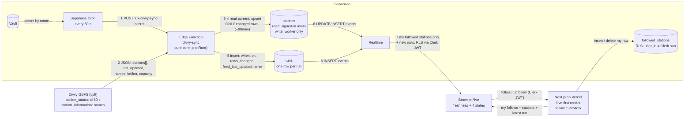

# Data flow: live Divvy stations

Drawn before any worker or migration code. The source measurements are in [`source.md`](source.md).

## What each hop sends

| # | from → to | payload |
|---|-----------|---------|
| 1 | Cron → Edge Function (pg_cron + pg_net) | HTTPS POST, empty body, with header `x-divvy-sync-secret`. The value is read from Vault **by name** at call time, so no key is in the migration or the repo. The function checks it with `divvy_sync_secret_ok()` and answers 401 if it is missing or wrong. |
| 2 | Edge Function → Divvy | Two GETs. `station_status` gives counts, flags, per-station `last_reported` and the feed's `last_updated`. `station_information` gives `name`, `lat`, `lon`, `capacity`. |
| 3 | Edge Function → `stations` | Selects the comparable columns of every station, to diff against. Uses the secret key Supabase injects into the function's environment, never one in code. |
| 4 | Edge Function → `stations` | Upserts on `station_id` **only for stations whose counts or flags changed**. `last_reported` alone doesn't count as a change (see `source.md`: about 750 heartbeat bumps a minute, about 80 real changes). |
| 5 | Edge Function → `runs` | One row per run, success or failure: `started_at`, `finished_at`, `ok`, `rows_changed`, `feed_last_updated`, `error`. |
| 6 | Postgres → Realtime | Logical replication of `stations` and `runs` through the `supabase_realtime` publication. |
| 7 | Realtime → browser | `postgres_changes` for `stations` with filter `station_id=in.(…followed ids…)`, plus `INSERT` on `runs`. Realtime checks each event against RLS using the user's Clerk JWT, passed with `realtime.setAuth`. |
| – | Browser ↔ Next.js ↔ `followed_stations` | Follow or unfollow through a server action using the user's Clerk token. RLS (`sub = user_id`) applies to select, insert and delete. The first render reads follows, their station rows and the latest run. |

## Freshness: two clocks, so a stale feed and a stopped worker look different

The page shows both:

- **Worker:** "updated 12 s ago", from the latest `runs.finished_at`. It ticks every second on the client and resets when a new `runs` row arrives over Realtime. A run with 0 changed rows still inserts a `runs` row, so a quiet minute doesn't look stale.
- **Divvy feed:** "published 40 s ago", from `runs.feed_last_updated`, the feed's own `last_updated` as seen by the latest run.

| state | condition | what the user sees |
|-------|-----------|--------------------|
| **loading** | first data or the subscription isn't ready yet | skeleton cards, "Connecting…" |
| **fresh** | latest run `ok`, `finished_at` ≤ 3 min ago, feed `last_updated` ≤ 3 min ago | normal cards, "updated N s ago" |
| **stale** | either clock is over 3 minutes (about 3 missed runs) | cards dimmed, a banner naming one cause. If the worker clock is behind, it names the **worker**: a stopped worker ages both clocks, because the feed time is only seen through runs. Otherwise it names **Divvy** ("hasn't published new data…; the worker is still running"). |
| **down** | latest run has `ok = false` | banner with the run time and its `error`. The last known counts stay visible, labelled with their age. |

Each state has a text label and an icon, not just a colour, and changes are announced through `aria-live="polite"`.

## Realtime volume estimate (5 open pages)

Assumptions: pages open 24/7 (worst case, 43,200 minutes a month), 10 followed stations per user, and about 80 of 2,079 stations changing per minute (measured).

| design | per page per minute | 5 pages, per month |
|--------|---------------------|--------------------|
| unfiltered `stations` subscription | about 80 | **about 17.3 M** |
| filtered to my follows, average station (3.9% chance of change per minute) | 10 × 0.039 ≈ 0.39 | about 84 k |
| filtered to my follows, busy stations (assume 15% per minute) | 10 × 0.15 = 1.5 | about 324 k |
| `runs` INSERT (freshness), always | 1 | 216 k |
| **total, filtered, busy-station case** | | **about 540 k** |

**Decision:** the filtered design is about 0.3–0.54 M a month, below the 1 M threshold (and the 2 M free-tier quota). So the worker keeps writing every changed station, not just followed ones. That keeps `stations` complete: a newly followed station has current data immediately, with no extra fetch. The unfiltered subscription (about 17 M) is ruled out, and so is counting `last_reported` as a change (about 160 M).

Limits that keep the estimate true:
- Realtime's `in` filter accepts at most 100 values, so `followed_stations` is capped at 50 per user by a trigger (the same pattern as `saved_cities`).
- With no follows, the page doesn't subscribe to `stations` at all.

## Why every 60 seconds

`station_status` advertises `ttl: 60`, and its `last_updated` moved by about 60 s on every fetch. Polling more often re-reads the same snapshot. Polling less often skips snapshots. At 60 s that is 43,200 Edge Function calls a month, about 9% of the 500,000 free quota.
